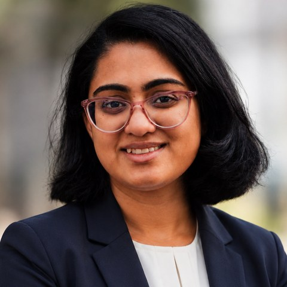

# Atishna Samantaray

Ph.D. student in Electrical and Computer Engineering at the **University of California, San Diego**, advised by [Prof. Pamela Cosman](https://jacobsschool.ucsd.edu/node/3287).

**Website:** [enable72.github.io](https://enable72.github.io) · [Google Scholar](https://scholar.google.com/citations?user=EjPaa_QAAAAJ&hl=en) · [LinkedIn](https://www.linkedin.com/in/atishna-samantaray-b7b24aa6/) · [Email](mailto:asamantaray@ucsd.edu)

## About Me

My research focuses on generative and diffusion models, multimodal video synthesis, and cross-view representation learning, with applications in perceptual image/video compression, 3D perception on autonomous-driving sensor data, and medical imaging.

I like designing and validating models end to end: from architecture and training to rigorous human and model evaluation. The ideas behind my projects are my own. I think a problem through from first principles, and I shape what I find into concrete, testable designs; that way of thinking is what I consider my greatest strength. Currently, I am working on reconstructing egocentric video from compact multimodal signals for AR/VR skill-transfer applications.

**Interests:** Generative Models · Diffusion Models · Multimodal Learning · Image & Video Compression · Cross-View Representation Learning · Medical Imaging · Human-Study Design

## News

- **2026** Our paper *Can We Remove the Ground? Obstacle-aware Point Cloud Compression for Remote Object Detection* was accepted at **ICNC 2026**.
- **2026** Submitted *Attention Where It Matters: Implicit Saliency Priors in Learned Image Compression* to **IEEE TIP**.
- **2026** Submitted *Cross-View Attention and Diffusion Synthesis for Maxillary Sinus Pathology Assessment* to **IEEE TMI**.
- **2024** Started my Ph.D. at UC San Diego.

## Research Projects

**Minimal-Signal Egocentric Reconstruction** (ongoing)
- Reconstructing egocentric video from a compact signal set: sparse exo/ego keyframes, head pose, gaze, hand-pose trajectories, and HOI masks.
- Formulating an event-driven anchor-refresh and bitrate allocation policy across modalities to cut storage and transmission cost while preserving reconstruction and action-recognition quality.

**Attention Where It Matters: Implicit Saliency Priors in Learned Image Compression** (submitted, IEEE TIP)
- Training-only Saliency-Driven Attention (SDA) injects human gaze maps as a soft multiplicative prior into transformer self-attention.
- 15–20% improvements in LPIPS and DISTS and 1.9x higher human preference over learned-compression baselines, across STF, TCM, and SwinT.
- Validated with a 30-participant human study (216 image pairs per participant); SDA preferred in 50.6% of trials vs. 31.6% for baselines (p < 0.001).

**Cross-View Attention and Diffusion Synthesis for Maxillary Sinus Pathology Assessment** (submitted, IEEE TMI)
- Structure-guided latent diffusion model (Stable Diffusion + LoRA, frozen VAE, DDIM) generating an expert-validated synthetic pathology dataset to address class imbalance across 194 patients.
- Bidirectional cross-view attention across CNN+ViT, YOLOv5, and ResNet18 backbones improved classification accuracy by up to 10.8%.

**Obstacle-Aware Point Cloud Compression for Remote Object Detection** (ICNC 2026)
- Lightweight, parallelizable Pillar-based Ground Removal (PGR) that drops non-informative ground points.
- 86.5 FPS with SECOND and PVT-SSD; up to 12.94% bitrate reduction with negligible mAP loss on Waymo Open Dataset and KITTI.

## Publications

1. A. Samantaray, X. Cai, K. Archambault, P. Cosman. *Cross-View Attention and Diffusion Synthesis for Maxillary Sinus Pathology Assessment.* IEEE Transactions on Medical Imaging (submitted).
2. A. Samantaray, T. Homavazir, G. Mundada, S. Kamate, P. Cosman. *Attention Where It Matters: Implicit Saliency Priors in Learned Image Compression.* IEEE Transactions on Image Processing (submitted).
3. P. Zeng, A. Presta, **A. Samantaray**, J. Reinis, D. Bharadia, H. Qiu, P. C. Cosman. *Can We Remove the Ground? Obstacle-aware Point Cloud Compression for Remote Object Detection.* 2026 International Conference on Computing, Networking and Communications (ICNC). [IEEE Xplore](https://ieeexplore.ieee.org/abstract/document/11416860)
4. A. Samantaray, S. Bandhyopadhyay, A. Pramanik. *Novel Algorithm for COVID-19 Variant Detection from Chest X-Rays.* De Gruyter, 2023.
5. A. Samantaray, S. Bhattacharya. *Fast Trilateral Filtering for Video Denoising.* IEEE ICCCA, 2020.

## Education

- **Ph.D., Electrical and Computer Engineering**, University of California, San Diego (Sep 2024 – Expected Jun 2028)
- **M.S., Electrical and Computer Engineering**, University of California, San Diego (Sep 2022 – Jun 2024)
- **B.Tech., Electronics and Telecommunication Engineering**, IIEST, Shibpur (Aug 2018 – Jun 2022)

## Teaching and Review

- Teaching Assistant, Advanced Data Structures and Algorithms (Spring 2023)
- Teaching Assistant, Applications of Digital Signal Processing (Spring 2024)
- Reviewer, ICVGIP 2026

## Technical Skills

- **Languages:** Python, C, C++, MATLAB, R
- **Frameworks and tools:** PyTorch, TensorFlow, Keras, OpenCV, scikit-learn, NumPy, SciPy, Pandas, Matplotlib, AWS, Docker, Git
- **Modeling:** Diffusion models (Stable Diffusion, LoRA), Transformers, CNNs, multimodal and cross-view representation learning, point cloud processing, human evaluation, visual quality assessment
